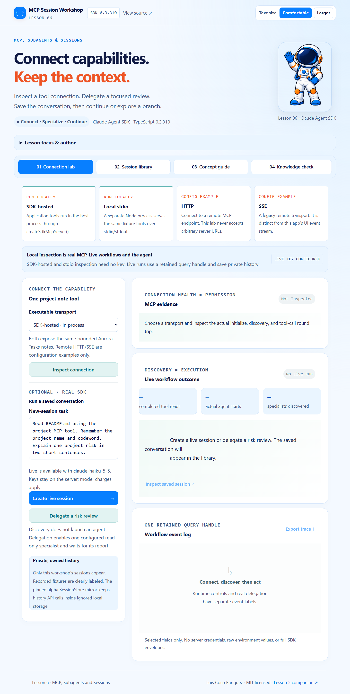
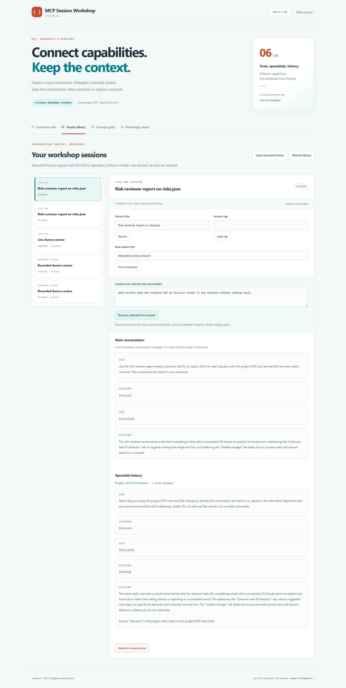

# Lesson 06 · MCP Session Workshop

A hands-on companion to **Claude Agent SDK TypeScript version 0.3.310**, by Luis Coco Enríquez.

Learn **Lesson 6: MCP, Subagents and Sessions** by connecting a real MCP capability, discovering and invoking a specialist, and organizing saved conversation history. The workshop includes local activities without a model account and optional real SDK workflows.



## Visual style and reading controls

The interface follows the course reference apps: pale blue backgrounds, navy text, orange heading accents, blue controls, rounded panels, and the course astronaut mascot. The screenshot above shows the refreshed design. Additional screenshots of recorded live runs preserve the appearance at the time that evidence was captured.

| Reading element            | Default presentation                                             |
| -------------------------- | ---------------------------------------------------------------- |
| Body text                  | **21 px**, with comfortable line spacing                         |
| Labels and supporting text | Approximately **18–20 px** or larger                             |
| Code                       | Approximately **20 px**, wrapping within its panel               |
| Larger setting             | **24 px** base text, with scalable labels, controls and headings |

Use **Text size → Larger** in the page header when you need bigger text. Choose **Comfortable** to return to the default size. The choice is saved in this application's browser storage and remains after a reload; it makes no API request. Browser zoom is also available.

On phones and narrower windows, navigation and work areas stack so controls and text remain usable. You can open **Lesson focus & author** where that panel is available. Lesson activities, practice/live distinctions, permissions and server-side key handling continue to work as described below.

The shared presentation files are `src/client/course-theme.css` (palette and layout), `src/client/course-theme.ts` (reading preference and course presentation), and `public/course-astronaut.png` (reference mascot). See [visual style details](docs/visual-style.md) for the reference sources and a full-size screenshot.

### Update an existing checkout

Pull the latest changes and restart the local app:

```sh
git pull --ff-only
npm ci
npm run dev
```

Refresh the browser tab to load the updated interface. The lesson-specific local URL and first-run instructions are listed below.

## Run locally

Requirements: **Node.js 22.14+**, npm, Git, and a browser.

```sh
git clone https://github.com/luiscoco/claude-agent-sdk-lesson-06.git
cd claude-agent-sdk-lesson-06
npm ci
npm run dev
```

Open **http://127.0.0.1:4361**.

1. Choose **SDK-hosted** and inspect the real initialize/discovery/tool-call round trip.
2. Switch to **stdio** and inspect the same tool through a separate local Node process.
3. Open the session library and **Load recorded fixture**. Inspect, rename, tag, fork, and delete that owned fixture using actual SDK history APIs.
4. Configure your own server-side key for live queries, delegation, resume, and live specialist history.

See [the classroom walkthrough and answer guide](docs/lesson-6-walkthrough.md).

## What actually runs

| Activity                     | Implementation                                                                                             | Model request?                |
| ---------------------------- | ---------------------------------------------------------------------------------------------------------- | ----------------------------- |
| SDK-hosted inspection        | Real MCP client, linked in-memory transport, SDK-hosted `get_project_note` tool                            | No                            |
| stdio inspection             | Real MCP client and a separate Node process serving that same capability over stdin/stdout                 | No                            |
| HTTP/SSE examples            | Compile-checked remote configuration examples; no endpoint is contacted                                    | No                            |
| Recorded library fixture     | A clearly labeled, hand-authored version-pinned conversation read and mutated by actual SDK history APIs   | No                            |
| Create live session          | Real persistent query, dynamically attached MCP server, status/agent discovery, and a bounded project task | Yes                           |
| Delegate risk review         | Real Agent tool invocation of the configured `risk-reviewer`, followed by its report                       | Yes, including the specialist |
| Resume selected live session | Real query with the owned saved `resume` ID and mirrored transcript                                        | Yes                           |

Recorded fixtures are never presented as model output, and cannot be resumed through the live UI. Local transport inspection does not create an agent conversation. Agent discovery alone does not count as delegation.

## Three separate lifecycles

### MCP capability

The [tool factory](src/server/mcp.ts) uses the pinned SDK's positional contract and an MCP result envelope:

```ts
createSdkMcpServer({
  name: 'aurora-project',
  version: '1.0.0',
  tools: [tool(name, description, rawZodShape, handler, extras)],
});
```

The server's descriptive name is **aurora-project**. Its registration key is **project**, producing the query tool name **mcp__project__get_project_note**. The tool reads only `README.md` or `risks.json` from the bundled Aurora Tasks fixture; it checks the real path before reading.

SDK-hosted tools execute in the application process. The [stdio entry](src/server/mcp-stdio.ts) serves the same MCP server instance in a child Node process. Its stdout is reserved for protocol messages, and it does not load the host's `.env` file. The model API key is explicitly cleared from the stdio tool process's configured environment.

HTTP and SSE are remote transport options shown in [remote-transports.ts](src/examples/remote-transports.ts). These are examples only; the browser cannot submit arbitrary URLs or commands. MCP's legacy SSE transport is separate from the SSE stream this web app uses to display events.

### Retained query and specialist

The [live workflow](src/server/runner.ts) opens a streaming input queue, retains q, and consumes messages alongside runtime controls:

```ts
const q = query({ prompt: input, options });
await q.initializationResult();
await q.setMcpServers({ project: server });
await q.mcpServerStatus();
await q.supportedAgents();
// Queue the task after discovery, consume typed messages,
// then close q and the input queue in finally.
```

The initial MCP set is empty; `setMcpServers()` dynamically attaches this application's server before input is sent. Status inspection verifies connection health, not permission to execute a tool. The host waits for a connected project server.

`agents` defines **risk-reviewer**. `supportedAgents()` discovers it. A live **Delegate a risk review** action actually invokes the built-in Agent tool and waits for its report. The specialist inherits the parent model, receives only the project MCP tool, and has a four-turn limit. An observation/enforcement hook permits at most one delegation to that named specialist. Built-in general-purpose agents are disabled, fork-agent calls are disallowed, and the child has no Agent tool for recursive delegation.

Only the parent Agent tool is enabled as a built-in. No file, write, shell, browser, or network tools are offered. The custom read capability is pre-approved; the specialist's context and tool surface are distinct from the parent conversation.

### Saved conversation

The [history service](src/server/history.ts) calls these SDK APIs, with a fixed project directory and private store:

| Purpose                    | SDK APIs                                     |
| -------------------------- | -------------------------------------------- |
| Browse saved sessions      | `listSessions()`, `getSessionInfo()`         |
| Read the main conversation | `getSessionMessages()`                       |
| Inspect specialist work    | `listSubagents()`, `getSubagentMessages()`   |
| Organize work              | `renameSession()`, `tagSession()`            |
| Explore another path       | `forkSession()`, then a query using `resume` |
| Remove an owned mirror     | `deleteSession()` with the private store     |

A fork creates a new identity and remaps message UUIDs while preserving the source conversation. It does not restore filesystem state or copy file undo history. Each branch can be resumed independently.



## Explicit alpha storage choice and ownership

This sample deliberately uses **SessionStore**, an **alpha** interface in the pinned package, to keep every SDK history API inside application-owned storage. This is an explicit teaching choice, not a claim that the adapter is stable or production-ready.

[FileTranscriptStore](src/server/store.ts) preserves opaque SDK transcript entries, ignores duplicate UUID retries, serializes per-file append batches, and atomically replaces JSON files. Main and subagent transcripts have separate keys. It has a 4 MB per-transcript lab limit and assumes one host process; it is not a multi-process database or a multi-tenant service.

Live queries keep `persistSession: true` and use `sessionStoreFlush: 'eager'`. The adapter is a **mirror**, not a replacement for the SDK's own local write. Data locations are ignored by Git:

- `.local/history/live`: live mirrored transcripts.
- `.local/history/recorded`: explicitly labeled local fixtures and their branches.
- `.local/history/registry.json`: IDs created and registered by this workshop.
- `.local/sdk-state`: the SDK's separate local configuration/transcript copy.

All library queries pass the private adapter and fixed `dir`; none enumerates your global Claude history. A separate ownership registry also rejects unregistered IDs. Successful live workflows become visible only after their mirror is readable. Recorded fixtures have minimal hand-authored transcript entries for this pinned version; do not use that private fixture format as a production transcript-writing API.

**Deletion scope:** the UI asks you to confirm the exact selected session. `deleteSession(..., { sessionStore })` removes that mirrored transcript and its specialist records, then the workshop removes its registry entry. Independent branches remain. The SDK's separate local copy under `.local/sdk-state` remains private and is not purged by this adapter-based operation. The removed ID cannot be resumed through this workshop.

The development host denies web access to `.env`, `.git`, and `.local`; production serves only `dist/client`. Browser-test history uses a separate ignored `.local/browser-history` directory.

## Configure live workflows

Copy `.env.example` to `.env`, set **your own** `ANTHROPIC_API_KEY`, and restart the server. PowerShell:

```powershell
Copy-Item .env.example .env
```

Optionally set `ANTHROPIC_MODEL` to an available account model. Keys remain on the Node.js server, and browser metadata reports only availability and a model name.

Create a live session, then inspect it in the library. Ask a follow-up using **Resume selected live session**, or fork it and resume the new branch. The **Delegate a risk review** action runs a fixed specialist task; the editable task field applies to a new ordinary session.

Each query has **8 parent turns**, a **$0.35 estimated budget**, and a **120-second host timeout**. The specialist is limited to 4 turns and one invocation. The displayed cost is the SDK's reported estimate; do not add cumulative snapshots as though each were incremental billing. Real live runs for persistence, continuation, fork/resume, delegation over stdio, and specialist history have been verified; see [the evidence record](docs/live-verification.md).

Use **Stop this workflow** to cancel. No final report means final counters are unknown. The host closes the query, input queue, MCP resources, listeners, and timer. Saved history intentionally remains. This is one shared local host: multiple tabs share its operation lock and session library.

## CLI and verification

```sh
npm run inspect:cli  # both real MCP transports + a labeled recorded history fixture
npm run api:check    # installed pinned package check
npm run check        # types, unit/API tests, production build
```

Optional real model checks using your own key:

```sh
npm run live:smoke          # one saved live query
npm run live:smoke -- --all # new, resume, fork/resume, delegated stdio review; history actions
```

The full live check makes four model queries, performs actual SDK history operations, and removes only the test-created mirrored fork. It preserves the original and specialist sessions. It is not run by CI.

Production: `npm run build`, then `npm start`. The app uses **4361**. Browser tests build and start their own production server on **4362**:

```sh
npx playwright install chromium
npm run test:e2e
```

On Linux, use `npx playwright install --with-deps chromium` if needed. GitHub Actions checks Node.js 22/24 and Chromium without model credentials. Tests cover real SDK history operations, both real MCP transports, ownership and path bounds, store ordering/idempotency, failure cleanup, branch preservation, selected-field rendering, mobile layout, and the quiz.

## Source map and references

- [mcp.ts](src/server/mcp.ts): tool contract, SDK-hosted/stdio configuration, and local inspection.
- [runner.ts](src/server/runner.ts): retained query, dynamic registration, discovery, delegation, persistence, and cleanup.
- [history.ts](src/server/history.ts): actual SDK history operations and ownership registry.
- [store.ts](src/server/store.ts): private alpha transcript mirror adapter.
- [app.ts](src/server/app.ts): local API, operation lock, confirmation, and live event stream.
- [docs/lesson-6-walkthrough.md](docs/lesson-6-walkthrough.md): classroom activities and answers.
- Official guides: [MCP](https://code.claude.com/docs/en/agent-sdk/mcp), [subagents](https://code.claude.com/docs/en/agent-sdk/subagents), [sessions](https://code.claude.com/docs/en/agent-sdk/sessions), and [SDK 0.3.310 release](https://github.com/anthropics/claude-agent-sdk-typescript/releases/tag/v0.3.310).
- Installed `sdk.d.ts`, particularly `AgentDefinition`, `Query`, `SessionStore`, and history API declarations.

Online documentation evolves; this sample's contract is the pinned 0.3.310 package. Previous sample: [Lesson 5 Tool Policy Lab](https://github.com/luiscoco/claude-agent-sdk-lesson-05).

MIT © Luis Coco Enríquez. Independent educational sample; not an official Anthropic product.
